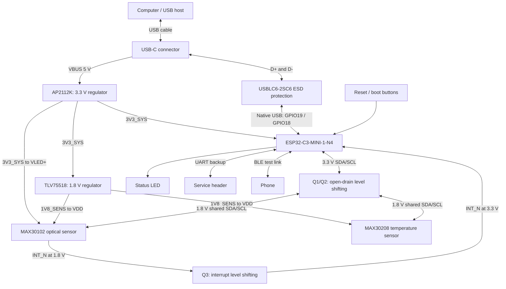

# Iteration 1 - schematic connection plan

Prepared 2026-10-18 from the [approved Iteration 1 decision](ITERATION_1_DECISION.md).

This document defines schematic blocks, signal connections and capture/review requirements. It is not a CAD schematic or a verified package pin map. GPIO assignments and initial passive values are proposals. Match every physical pad and electrical limit to the exact manufacturer's datasheet before capture; live datasheet and sourcing verification remain outstanding.

## 1. Top-level flow



All blocks share an electrically continuous **GND** reference. Ground is omitted from the diagram for readability. There is no battery, charger, display, external flash or external RF antenna component in this iteration; the selected module contains its own antenna and flash.

## 2. Suggested schematic sheets

| Sheet | Content |
|---|---|
| 00_TOP | Hierarchical blocks, named power rails and signal buses |
| 01_USB_POWER | USB-C, CC resistors, ESD protection, 3.3 V and 1.8 V regulators, decoupling and power test points |
| 02_ESP32_CONTROL | Module, EN/reset network, boot straps, USB connections, UART header, indicators and spare GPIO labels |
| 03_SENSOR_INTERFACE | SDA/SCL/INT level translation, shared bus pull-ups and bus test points |
| 04_SENSORS | MAX30102, MAX30208, sensor decoupling, optical/thermal placement notes and local supply measurement links |

These are drawing sections, not separate physical boards. Reference designators below are reserved planning labels and can be assigned consistently during CAD capture.

## 3. Power connections

| Net | Source | Destinations | Capture requirements |
|---|---|---|---|
| USB_5V | USB-C VBUS pins | AP2112K input; USB protection reference where required by its datasheet; test point | Join the connector's VBUS contacts correctly. Check source current limits and input inrush. |
| 3V3_SYS | AP2112K output | ESP32 3V3, MAX30102 VLED+, TLV75518 input, high-side pull-ups, indicators and module startup circuit | Verify tolerance, transient droop, LDO stability and thermal dissipation. |
| 1V8_SENS | TLV75518 output | MAX30102 VDD, MAX30208 VDD, low-side pull-ups and translator gates | Never connect MAX30102 core VDD to 3.3 V. Check rail sequencing and both sensors' operating limits. |
| GND | Common board ground | Connector ground, regulator ground, module ground pads, sensor ground pins and all circuit returns | Follow package/reference-layout requirements for every ground pad, including optical power-ground pins. |

Connect regulator enable pins deliberately for the intended always-on USB behavior; do not leave them floating. Verify pinout and NC instructions for the exact AP2112K and TLV75518 package variants. No regulator pin numbers are inferred from generic symbols.

Place the manufacturer's required input/output capacitors directly at each regulator. Provide local sensor decoupling and bulk capacitance for ESP32 and optical LED load steps. Choose effective capacitance after DC-bias derating; do not copy nominal values without checking stability and USB inrush.

The two sensors may use individually accessible supply links/test pads for current measurement. Any series component in VLED+ must be checked for voltage drop during pulses; do not add a large isolation resistor merely to reduce noise.

### Thermal and transient checks

- AP2112K dissipation is approximately `(USB_5V - 3V3_SYS) * output current`. At 5 V input and 200 mA output, this is about **0.34 W**, before quiescent losses. This is an illustrative load, not a measured consumption figure.
- The 600 mA rating does not establish safe continuous output on this PCB. Evaluate ambient temperature, copper area, thermal resistance and simultaneous processor/radio/LED loads. If the LDO fails the thermal budget, revisit the regulator before layout.
- Datasheet revisions disagree on the nominal LED supply (3.3 V in one, 5.0 V in another; absolute maximum 6.0 V), so read the VLED+ minimum in the revision for the ordered part. Check the optical LED rail against the sensor's minimum allowed supply during LED/radio pulses, including regulator tolerance, cable drop and interconnect resistance.
- Keep processor/radio and LED return-current loops from passing through sensitive sensor routing. Use a continuous ground reference with deliberate placement and routing, not arbitrary split ground planes.

## 4. USB-C and native USB

| Connector / interface item | Connection |
|---|---|
| VBUS | USB_5V |
| Ground contacts | GND |
| CC1 | Its own 5.1 kohm resistor to GND |
| CC2 | Its own 5.1 kohm resistor to GND; do not join CC1 to CC2 |
| D+ contacts | Join the duplicated USB 2.0 D+ contacts near the connector, through the protection/routing network, to ESP32 GPIO19 |
| D- contacts | Join the duplicated USB 2.0 D- contacts near the connector, through the protection/routing network, to ESP32 GPIO18 |
| SBU / unused contacts | Follow the exact connector drawing and USB 2.0-only application; do not assign them to unrelated signals |
| Shell / shield | Define a deliberate chassis/board-ground connection for this plastic-enclosure prototype; review the ESD return path |

USBLC6-2SC6 is a shunt protection device on the data lines, not a signal-processing bridge. Connect its line, VBUS-reference and ground pins exactly as specified by ST. Place it at the connector with a short ground return.

Reserve series-resistor footprints near the ESP32 USB pins; choose population/values using the Espressif reference design. Route D+/D- as a short, continuous USB differential pair with the required impedance and minimal stubs. Verify connector signal names against pad numbers and footprint orientation.

The USB-C CC resistors identify a sink; they do not negotiate USB Power Delivery or guarantee unrestricted current. Keep startup behavior and any bulk capacitance within the chosen USB supply arrangement, and respect host enumeration/current limits.

Use the ESP32's native USB Serial/JTAG for programming, logging and debugging. Do not add a CP2102/CH340 solely for this path, and do not label the interface SWD.

## 5. Proposed GPIO allocation

| ESP32 signal | Proposed use | Net / note |
|---|---|---|
| GPIO0 | I2C SDA | SDA_3V3 through Q1 |
| GPIO1 | I2C SCL | SCL_3V3 through Q2 |
| GPIO3 | Optical interrupt input | PPG_INT_3V3_N through Q3 |
| GPIO10 | Firmware status LED | Series resistor and LED; select active polarity explicitly |
| GPIO18 | Native USB D- | Reserved for USB |
| GPIO19 | Native USB D+ | Reserved for USB |
| GPIO20 | UART0 RX | Header TX from external adapter |
| GPIO21 | UART0 TX | Header RX to external adapter |
| EN | Reset/enable | Pull-up/RC and reset button per Espressif reference |
| GPIO9 | Download-mode strap | Boot button to GND with the specified strap circuit |
| GPIO2 / GPIO8 | Boot-strapping considerations | Reserve and set required boot levels from the exact module documentation |
| GPIO4-GPIO7 | Spare / possible external JTAG | Leave available in this proposal; USB Serial/JTAG is the primary debug path |

These are **SoC GPIO names, not module pad numbers**. Before drawing connections, confirm exposure on ESP32-C3-MINI-1-N4, module-internal flash reservations, reset behavior and any alternate-function conflicts. The firmware pin configuration must match this table after review.

The reset button pulls EN low; the boot button establishes the download strap during reset. Validate the complete strap combination and reset timing, rather than assuming a boot button alone guarantees recovery. Do not use a status LED on a boot strap in this proposal.

## 6. Sensor-bus translation

For each selected BSS138 open-drain translator:

```text
             1V8_SENS                         3V3_SYS
                |                               |
             pull-up                         pull-up
                |                               |
sensor signal --+-- SOURCE   BSS138   DRAIN ------+-- ESP32 signal
                              |
                             GATE
                              |
                           1V8_SENS
```

- Q1 translates SDA, Q2 translates SCL and Q3 translates the MAX30102 active-low interrupt.
- The MOSFET source belongs on the low-voltage side and drain on the high-voltage side; verify actual G/S/D package pad numbering. A generic MOSFET symbol must not silently swap source and drain.
- Begin with 4.7 kohm pull-ups on both sides and 100 kHz I2C. Check total bus capacitance, rise time, pull-up current, sink capability and actual low-level voltage. The pulling device can have to sink current from both pull-ups.
- These networks are for open-drain lines. Configure ESP32 SDA/SCL accordingly and INT as an input. Do not treat them as universal push-pull level translators.
- Verify transistor operation with a 1.8 V gate, the sensors' exact input/output thresholds, their interrupt output type, and power-up/power-down behavior.
- **Review finding (2026-10-20):** the MAX30208 runs from 1.7-3.6 V, so it can sit on a 3.3 V bus. MAX30102 VIH/VIL are 0.7/0.3 x VDD, so a 1.8 V core sees ~1.26 V as high. Whether MAX30102 SDA/SCL/INT tolerate 3.3 V pull-ups (absolute-maximum rating of those pins) was **not** confirmed in this review because the PDF could not be fetched. Read that table; if it permits 3.3 V, drop Q1-Q3 and pull up to 3V3_SYS. The BSS138 gate-threshold margin at a 1.8 V gate also needs checking if the translators stay.
- The three-transistor network is the approved starting topology, not proof that translation is necessary on every pin. If both sensor datasheets explicitly permit direct 3.3 V bus pull-ups, document that evidence before simplifying the circuit. Do not infer tolerance from the core supply voltage or another sensor's ratings.

## 7. Sensor connections

### MAX30102

| Sensor signal | Connect to |
|---|---|
| VDD | 1V8_SENS with datasheet-specified local decoupling |
| VLED+ | 3V3_SYS with local LED pulse-current decoupling |
| Ground pins | GND, following the recommended optical/LED return layout |
| SDA / SCL | SDA_1V8 / SCL_1V8 shared with MAX30208 |
| INT | PPG_INT_1V8_N into Q3 and a test point |
| Other / NC pins | Exactly as directed in the MAX30102EFD+T package datasheet |

The expected MAX30102 7-bit I2C address is **0x57**; verify against the exact datasheet and use a consistent 7-bit convention in firmware. The INT handler should schedule FIFO service; do not perform lengthy logging inside an interrupt handler. Log sample counters, capture timestamps, LED/sample settings and FIFO overflow status so apparently smooth output cannot hide lost samples.

Confirm sampling rate, pulse width, ADC range and LED current together. Start at conservative optical settings, check saturation and signal quality, then adjust. Red and IR measurements need stable contact and light exclusion. No additional discrete emitter or detector is required.

### MAX30208

| Sensor signal | Connect to |
|---|---|
| VDD | 1V8_SENS with local decoupling |
| GND | Common ground through the intended thermally isolated layout |
| SDA / SCL | The same SDA_1V8 / SCL_1V8 bus |
| GPIO0 / GPIO1 | These are the I2C address-select pins: their state at power-up sets the last two address bits (datasheet: GPIO0/GPIO1 default to mode 10 and set the address). Tie each to a deliberate level, never float them. The alarm/convert functions stay unused for polled acquisition |
| Other / NC pins | Per the exact package datasheet; do not invent address-strap pins |

The address is selected by GPIO0/GPIO1 (see table). Pick a level for each, check the address table in the datasheet, and avoid 0x57 (MAX30102). Record the address in the schematic notes and firmware. Verify both sensors can coexist on the shared bus before capture.

Place the sensor where it can be thermally coupled to the skin while being weakly coupled to regulator/module heat. A PCB tab or island can reduce heat conduction, but trace width, copper pours and mounting hardware all affect it. Electrical ground remains common. Define the contact material and mounting method together with the PCB placement.

## 8. Controls, indicators and service access

- Power LED: 3V3_SYS through a resistor and LED to GND. Use modest current and keep emitted light away from MAX30102.
- Status LED: GPIO10 through a resistor/LED with explicit polarity, default-off behavior and acceptable GPIO current.
- UART header: labeled GND, TX, RX and 3.3 V reference. TX/RX labels refer to the board. The external adapter must use 3.3 V logic. Do not connect a second power source to the reference pin while USB powers the board.
- Label test points on both sides of the bus translator where practical. Do not add long USB data-line test stubs.
- Provide access to reset/boot controls while the sensor is held against a finger or fixture.
- Internal module flash stores firmware/settings and only deliberately budgeted logs. No external memory circuit is added. Long captures go to the computer.

## 9. Schematic release checklist

Before treating the schematic as ready for layout:

1. **Symbols and footprints:** exact module/package variant, manufacturer pad numbering, exposed/ground/NC pads, USB orientation and optical keep-clear areas independently checked.
2. **Power:** complete operating/transient current budget; USB input restrictions; regulator dropout, stability and thermal checks; capacitor ratings and effective capacitance verified.
3. **Logic:** I2C addresses, thresholds, interrupt type, translator direction, rise time and partial-power behavior checked against exact datasheets.
4. **Boot/debug:** final GPIO/module-pad map, all strapping levels, EN timing, native USB and UART recovery connections reviewed.
5. **Physical requirements:** optical access/gasket, skin-temperature thermal path, module antenna clearance and connector/probe access represented as drawing/layout constraints.
6. **Documentation:** all passive values and MPNs completed; pin assignments shared with firmware; power flags and deliberate no-connects documented; ERC findings resolved.

Before fabrication, also complete placement/routing, DRC/DFM, assembly and mechanical reviews. A clean ERC does not verify optical contact, skin-temperature accuracy, radio behavior or regulatory performance.

## 10. Bring-up sequence

1. Inspect assembly and check for shorts before power.
2. Use a current-limited supply; verify 3.3 V/1.8 V rails and regulator temperature.
3. Verify reset/download recovery and USB logging without active optical pulses or wireless traffic.
4. Check sensor communication individually, then on the shared bus; inspect translated waveforms.
5. Read temperature at low duty cycle and record room/reference response.
6. Enable conservative red/IR acquisition; capture raw waveforms and monitor FIFO/gap status.
7. Test steady contact and HR/reference agreement; evaluate SpO2 as a provisional estimate with appropriate reference data.
8. Add BLE activity and repeat power, sample-loss and temperature-bias checks.

Current deliverable: this connection plan. Next deliverable: an actual CAD schematic, reviewed footprint set and completed schematic BOM. No new component substitution, fabrication release or hardware measurement is implied by this plan.
